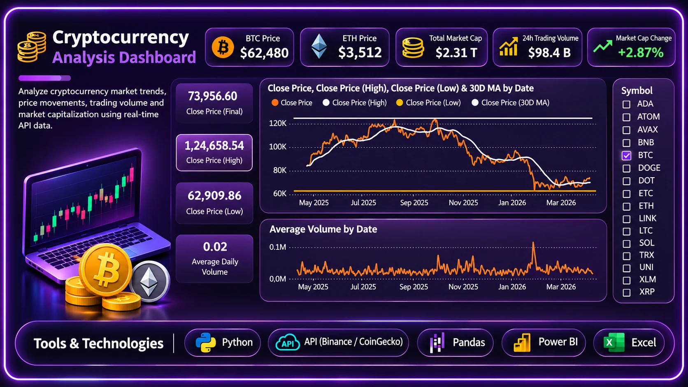
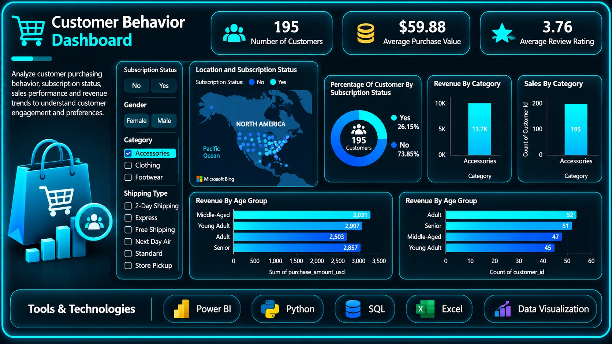
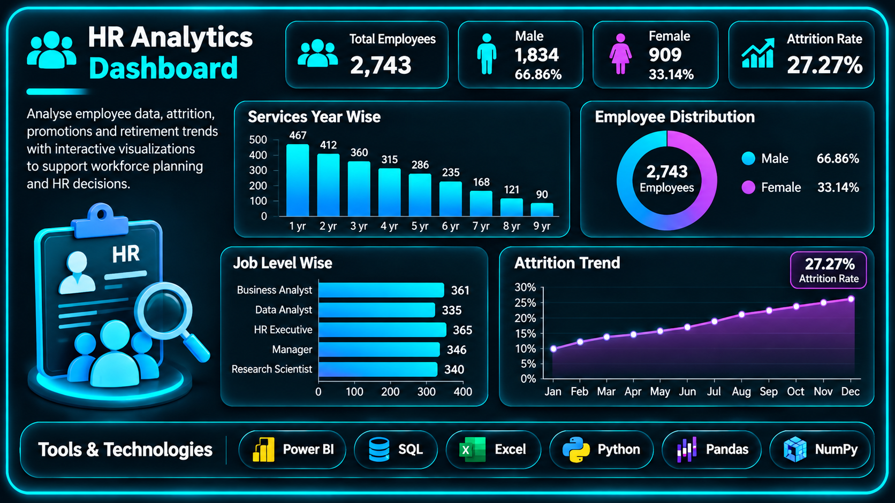
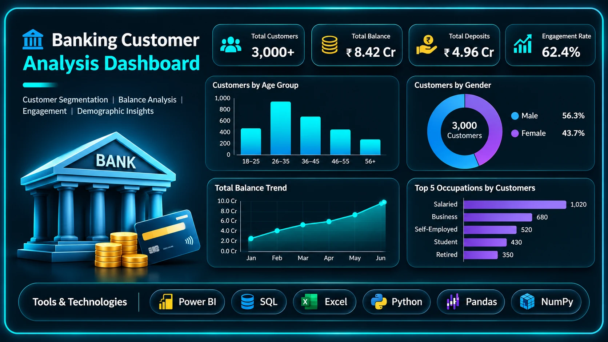
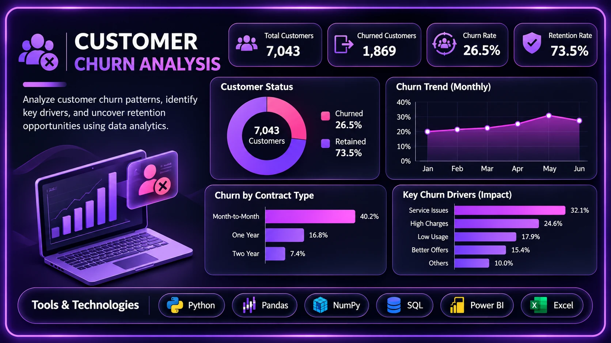

# Suraj Sutar — Data Analyst Portfolio

**Turning raw data into meaningful insights and decision-ready dashboards.**

---

## 👋 About

I'm a **Data Analyst and MIS Executive** with a B.Tech in Computer Science & Engineering (2026).

I work with **Python, SQL, Advanced Excel, and Power BI** to clean and analyze data, identify business trends, develop interactive dashboards, and communicate actionable insights.

Currently working as an **MIS Executive at GK Energy Ltd.**, with previous hands-on Data Analytics internship experience at **Maxgen Technologies Pvt. Ltd.**

This repository showcases my personal portfolio, featuring analytics projects, dashboard development, technical skills, and professional experience.

---

## 🛠️ Skills

**Core Skills:** Data Cleaning · Exploratory Data Analysis · Data Validation · SQL Queries · KPI Reporting · Dashboard Development · Data Visualization · MIS Reporting

---

## 📊 Featured Projects

### 01. Cryptocurrency Market Analysis

**Python | Pandas | NumPy | Binance API | CoinGecko API | Power BI**

- Analyzed cryptocurrency price movements, trading volume, and market capitalization.
- Collected market data using external APIs.
- Explored historical market trends through exploratory data analysis.
- Developed visualizations to communicate market insights.

[View Project Repository →](https://github.com/SurajSutar07/Crypto-Market-Analysis)

---

### 02. Customer Behavior Analysis

**Python | SQL | Power BI | Excel | Pandas | NumPy**

- Analyzed customer purchasing patterns and engagement trends.
- Examined customer segments and product category performance.
- Identified meaningful patterns through exploratory data analysis.
- Presented findings through visual reports and dashboards.

[View Project Repository →](https://github.com/SurajSutar07/Customer-Behavior-Analysis)

---

### 03. HR Analytics Dashboard

**Power BI | Excel | HR Analytics**

- Analyzed workforce distribution and employee demographics.
- Evaluated promotion and retirement eligibility.
- Examined service years, job levels, job satisfaction, and workforce distribution.
- Designed Home, Action, and Detail dashboard pages.

[View Project Repository →](https://github.com/SurajSutar07/HR-Analytics)

---

### 04. Banking Customer Analysis Dashboard

**Power BI | SQL | Python | Advanced Excel**

- Analyzed 3,000+ banking customer records.
- Evaluated customer demographics, deposits, and account balances.
- Examined customer engagement and segmentation.
- Developed an interactive Power BI dashboard with KPI cards and visualizations.

[View Project Repository →](https://github.com/SurajSutar07/Banking-Customer-Analysis)

---

### 05. Customer Churn Analysis

**Python | Pandas | NumPy | SQL | Power BI | Excel**

- Performed exploratory analysis of customer churn patterns.
- Examined customer segments and potential retention risks.
- Applied data cleaning and analytical techniques.
- Communicated findings through visual reporting.

[Explore My GitHub Projects →](https://github.com/SurajSutar07)

---

## 💼 Experience

### MIS Executive — GK Energy Ltd.

**June 2026 – Present**

- Prepare daily, weekly, and monthly MIS reports.
- Manage operational data, data consolidation, and reporting records.
- Perform data validation and accuracy checks.
- Develop Excel reports using Pivot Tables, XLOOKUP, and INDEX-MATCH.
- Monitor business performance and reporting requirements.

### Data Analyst Intern — Maxgen Technologies Pvt. Ltd.

**December 2025 – May 2026**

- Performed data cleaning and exploratory data analysis.
- Analyzed datasets using Python, Pandas, and NumPy.
- Wrote SQL queries for data retrieval and analysis.
- Developed Power BI dashboards and analytical reports.
- Used Advanced Excel for reporting and data analysis.

### Python Development Intern — Tecspeak IT Solutions

**August 2023**

- Developed Python scripts for repetitive task automation.
- Applied programming fundamentals to practical tasks.

---

## 🎓 Education

**Bachelor of Technology — Computer Science & Engineering**

Sharad Institute of Technology, College of Engineering, Ichalkaranji

Graduation: 2026

---

## 📜 Certifications

- AWS Academy — Cloud Foundations
- AWS Academy — Machine Learning
- Tata Data Visualisation Virtual Experience Programme
- Deloitte Data Analytics Job Simulation
- AICTE Eduskills Virtual Internship

---

## 📬 Connect With Me

I'm interested in opportunities in **Data Analytics, Business Intelligence, Business Analysis, and MIS Reporting**.

- **Email:** [sutarsuraj843@gmail.com](mailto:sutarsuraj843@gmail.com)
- **LinkedIn:** [Suraj Sutar](https://linkedin.com/in/surajsutar2005)
- **GitHub:** [SurajSutar07](https://github.com/SurajSutar07)

---

### DATA • ANALYTICS • DASHBOARDS • BUSINESS INSIGHTS

*Turning data into clarity. Turning insights into impact.*

